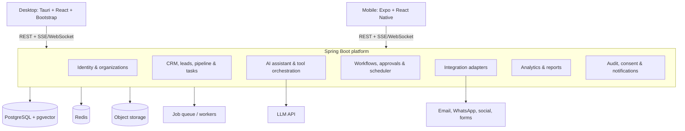
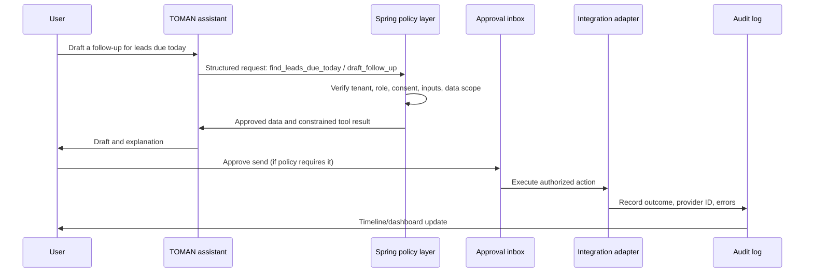

# System Architecture

## 1. High-level design

Start with a **modular Spring Boot monolith**, not microservices. It gives TOMAN one deployable backend for the MVP while enforcing clear domain boundaries that can later be extracted only when scale or team ownership justifies it.

## 2. Client architecture

### Desktop application

- **React + TypeScript + Vite** provides the dashboard UI.
- **Tauri** packages it as a Windows/macOS/Linux desktop app. Choose Electron only if future native Node integrations specifically need it.
- **Bootstrap 5 / React-Bootstrap** supplies responsive dashboard styling, forms, tables, modals, navigation, and accessible primitives.
- State: server state cache (for example, TanStack Query) plus a lightweight local UI store.
- Desktop priorities: command center, pipeline board, approval inbox, campaign calendar, reports, team administration, and assistant workspace.

### Mobile application

- **Expo + React Native + TypeScript** targets Android and iOS.
- Use native components and TOMAN design tokens, not Bootstrap CSS. A native component library or StyleSheet-based component system can mirror the desktop visual language.
- Mobile priorities: notification-driven work, today's tasks, lead/customer lookup, lead-stage update, conversation summary, and assistant chat.
- Cache only the recent task/lead view for offline-friendly reading; server remains the source of truth for writes and approvals.

### Shared frontend code

Share API types, validation schemas, domain constants, icons, and design tokens. Do not try to share Bootstrap components with React Native.

## 3. Backend modules

| Module | Responsibility |
| --- | --- |
| Identity & organizations | OIDC login, membership, roles, tenant context, organization settings. |
| Catalog | Products/services, offers, FAQs, pricing, approved source knowledge. |
| CRM | Customers, companies, leads, deals, stages, assignments, tasks, timelines, deduplication. |
| Inbox | Normalized conversations/messages, channel metadata, human escalation. |
| Campaigns | Content drafts, templates, calendars, review and scheduled publishing requests. |
| Assistant | Intent extraction, tenant-scoped retrieval, structured tool proposals, response summaries. |
| Workflows | Triggers, conditions, approvals, scheduled work, retries, and idempotent runs. |
| Integrations | OAuth/credentials, webhooks, provider-specific adapters, rate limits, retries. |
| Analytics | Metric snapshots, dashboards, data completeness labels, report exports. |
| Trust & operations | Consent, unsubscribe, audit events, notification delivery, monitoring hooks. |

Each module exposes internal application services; other modules use those services rather than bypassing their rules by directly reading tables.

## 4. Data and asynchronous work

### Storage

- **PostgreSQL** is the system of record. Use `organization_id` on every tenant-owned record, foreign keys for CRM integrity, JSONB for provider payloads, and `pgvector` only for approved knowledge retrieval.
- **Redis** handles cache, rate limiting, short-lived locks, session-like ephemeral state, and lightweight queued work.
- **S3-compatible object storage** keeps attachments, imports, generated reports, and campaign assets.
- Add a durable queue such as RabbitMQ or a managed cloud queue when sends/webhooks need reliable delayed retries and a dead-letter path.

### Core entities

`Organization`, `User`, `Membership`, `Product`, `Offer`, `Customer`, `Company`, `Lead`, `PipelineStage`, `Deal`, `LeadActivity`, `Task`, `Conversation`, `Message`, `Campaign`, `ContentDraft`, `Approval`, `Workflow`, `WorkflowRun`, `IntegrationConnection`, `Consent`, `AuditEvent`, and `MetricSnapshot`.

### Background jobs

- Inbound webhook normalization and idempotent processing.
- Follow-up reminders and scheduled sequences.
- Approved email/post send attempts, retries, and provider status updates.
- Metric snapshots, report generation, and stale-lead detection.
- Content-calendar scheduling and workflow execution.

## 5. AI safety and execution boundary

The model is an assistant that produces a typed proposal; it is not an authorization system or direct integration client.

Rules:

- The LLM receives only the minimum tenant-scoped, approved context needed for its task.
- Tool inputs and outputs use schemas; Spring Boot validates every input before executing a domain action.
- Sending, publishing, price/stock changes, and workflow activation require configurable approval policies.
- Untrusted inbound messages are treated as data, never as instructions.
- Store action proposal, approver, final result, and errors in an immutable audit trail.
- Label generated content, estimates, and forecasts; show supporting data and missing-data limitations.

## 6. Security and tenant isolation

- Use an external OIDC/OAuth2 identity provider; Spring Security validates access tokens and resolves membership/role.
- Roles begin with Owner, Manager, Sales Rep, and Viewer; authorization is checked at endpoint and domain-service level.
- Encrypt integration credentials at rest using a managed secrets/KMS service. Never send them to clients or the LLM.
- Validate webhook signatures, apply idempotency keys, isolate provider failures, and rate-limit public endpoints.
- Build consent, unsubscribe, data retention/deletion, and export requests into the data model from the start.
- Keep audit events append-only and monitor authentication failures, approvals, integration errors, and unusual tool activity.

## 7. Deployment path

1. **Local:** Docker Compose for PostgreSQL, Redis, object-storage emulator, and the API; desktop/mobile point to a local API.
2. **Pilot:** Containerized Spring Boot API and worker, managed PostgreSQL/Redis/object storage, secrets manager, centralized logs, and daily backups.
3. **Scale:** Separate workers and integration adapters first; extract a service only when a module has independent scaling, reliability, or ownership needs.

## 8. Initial API surface

- `POST /auth/session` / OIDC callback and token refresh handled through the chosen identity setup.
- `GET|POST /organizations`, `GET|POST /memberships`.
- `GET|POST /leads`, `PATCH /leads/{id}`, `POST /leads/{id}/activities`.
- `GET|POST /tasks`, `PATCH /tasks/{id}`.
- `GET|POST /products`, `GET|POST /campaigns`.
- `POST /assistant/commands`, `GET /assistant/runs/{id}`.
- `GET|POST /approvals`, `POST /approvals/{id}/approve`, `POST /approvals/{id}/reject`.
- `POST /webhooks/{provider}`, `GET|POST /integrations`.
- `GET /dashboard/summary`, `GET /reports/sales`.

Publish an OpenAPI contract from Spring Boot and generate the shared TypeScript API client from it.
